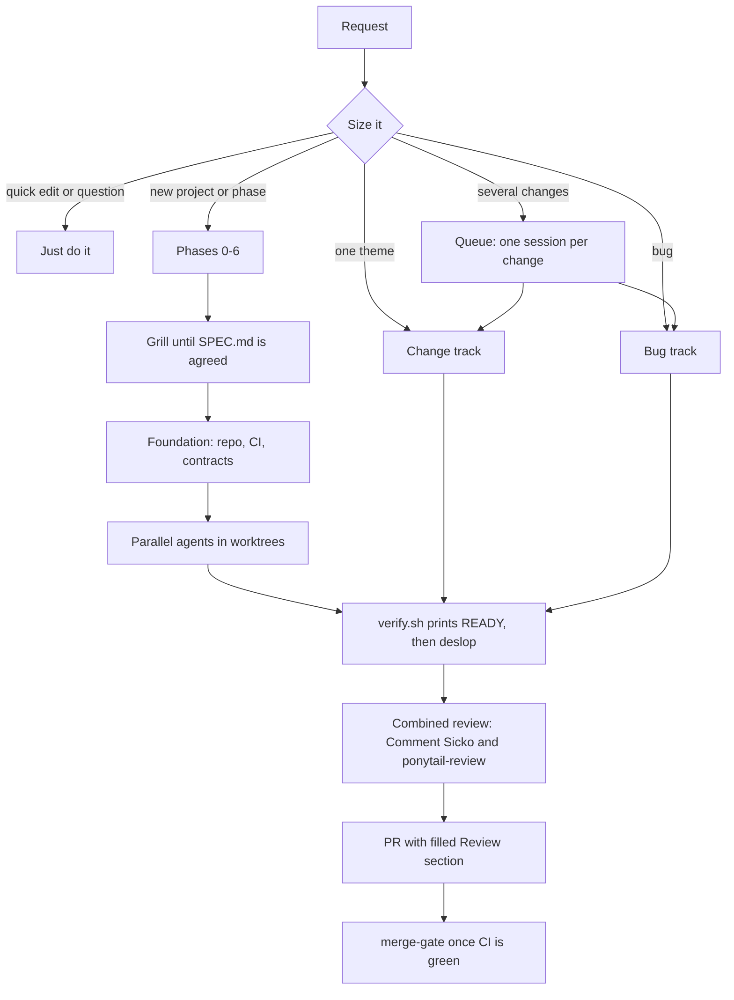

# orchestrator-skill

My default workflow for agentic coding projects, as a Claude Code skill. The `orchestrated-build` skill makes Claude the orchestrator: it owns the spec, the contracts, the merges and the final verification, while subagents write most of the code and I make the decisions.

## How it works

The skill sizes each request first, then picks a track:



| Request | Track |
|---|---|
| Quick edit or question | Just do it |
| One theme: a feature, a UI pass, a refactor | Change track |
| A bug | Bug track: failing test first, then root-cause fix |
| Several independent changes | Queue: one session per change |
| New project, new phase, or modules sharing new contracts | Phases 0–6 |

The phases (`phases.md`):

0. Gather facts before asking anything
1. Grill until `SPEC.md` is agreed
2. Set up the repo: branch, CI, `verify.sh`, merge gate, main-checkout guard
3. Build a foundation, then fan out parallel agents in worktrees
4. One PR per agent, then verify the real thing
5. Independent review of the whole phase against the spec
6. Ship

Every PR gets a combined review (Comment Sicko plus `ponytail-review`), a filled `## Review` section, and merges only through `scripts/merge-gate.mjs` once CI is green. Long builds hand over through a resume note and continue in a fresh session per part.

## Layout

```
orchestrated-build/
  SKILL.md       sizing, tracks, review and merge rules, pausing and picking up
  phases.md      Phases 0–6 and adopting an existing repo
  templates/     files copied into a project: AGENTS.md, ci.yml, verify.sh,
                 merge-gate.mjs, guard-main-checkout.mjs, agent-setup.sh,
                 agent and review briefs, hand-over note, module map
```

## Install

Copy the skill into your user skills folder:

```bash
cp -R orchestrated-build ~/.claude/skills/
```

Then ask Claude to build something ("new project", "spec this", "delegate to agents"), or invoke it directly with `/orchestrated-build`.

## Dependencies

The skill calls other skills by name and expects them to be installed: `grilling`, `diagnosing-bugs`, `tdd` (mattpocock/skills); `ponytail` and `ponytail-review`; pstack's `poteto-mode` principles; `impeccable` and Emil Kowalski's UI skills for UI work; `thermo-nuclear-code-quality-review`; `claude-api`. Comment Sicko and deslop are bundled in `templates/`.

It is written for my setup (identity, GitHub account, Notion rules in the standing rules of `SKILL.md`), so edit those before reusing it.
